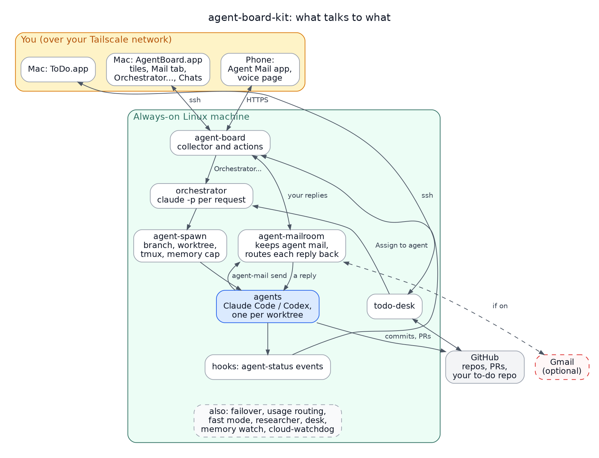

# Getting started: your own agent board, from nothing to a working setup

This is the whole setup in one ordered walk-through, for someone who has never seen it. Every step says what
to do and how to check it worked. The numbered guides (01 to 09, in the repo's `docs/` folder) have more detail,
and this page links to them where it matters.

**What you will have at the end:**

- **Agents you start and steer from the board.** The **agent board** is a Mac menu-bar app. Type to the
  **orchestrator** ("start an agent on my-repo to fix the login redirect"), and an agent (Claude Code or Codex)
  starts in its own git branch and worktree on your Linux machine, does the work, and writes to you.
- **Your mail with your agents, without email.** What agents write to you lands in the board's **Mail** tab,
  and in the **Agent Mail** app on your phone. Your reply there reaches that same agent within a second or two,
  even hours later. Nothing goes through Gmail or any other mail service.
- **Everything at a glance.** Every agent is a coloured tile (busy, waiting on you, blocked, idle), with group
  **Chats**, what you sent and what is done, plan usage and where your time went.
- **A to-do list agents can work on.** Your tasks are issues in a private GitHub repo, edited from a Mac app or a
  web page, and **Assign to agent** starts an agent on a task.

**Everything in the kit**, grouped (✓ = on after the core install; the rest is one switch in `kit.env` or a
setting away, all covered below):

- **Your mail with agents:** ✓ the board's Mail tab (threads, search, snooze, undo, comments on text, options and
  plots, files and screenshots, drafts kept on the Linux machine, pop-out windows); the Agent Mail phone app;
  ✓ **fast mode** for quick back-and-forths; ✓ group **chats** with topics; ✓ **Sent** (what you asked for, and what
  agents say is done); Forward to anyone through your Gmail; Gmail itself, optional.
- **Running agents:** ✓ the orchestrator (from the board, the phone or the to-do apps); ✓ one branch, worktree,
  tmux session and memory cap per agent, closed only once its work is landed; the **Researcher** switch (a public
  research-workflow plugin); **several Claude logins** with usage routing, **failover** when one runs out and a mail
  while agents bill extra usage; **Codex** agents; a **per-token login** through OpenRouter, with a spend meter;
  ✓ switching an agent's login or model from its tile; ✓ restart-and-resume after OS updates; ✓ Claude Code and Codex
  kept updated.
- **Seeing what is going on:** ✓ tiles by state, with a notification when one turns red; ✓ **plan usage** and where
  it went, by group and agent; ✓ the **Time** page (where your time went); **meeting alerts**; ✓ free status notes and
  reports; ✓ security alerts on the Mac.
- **Voice and the desktop:** the **ask box** on the Mac (⌃⌥A; type or dictate, hear the answer); the **desk**, one
  always-running Claude you talk to; the **voice page** on your phone (Gemini Live); **unlocking the desktop's
  keyring** from the Mac or phone; a **transcript archive** of every agent session.
- **Elsewhere:** ✓ the **to-do list** (Mac app, web page, Triage, Assign to agent); **cloud-watchdog** for paid cloud
  resources; the **reMarkable** route (documents from your tablet start a reader agent; needs Gmail); ✓ memory
  watch; mail backup.

**Time:** about 1.5 hours for the core on the Linux machine and the Mac, plus 20 minutes for the phone app and
15 minutes for the to-do web page. **Cost:** the Claude plan you already pay for. A Max plan suits several agents
at once. Tailscale's free personal plan covers the private network.

## 1. How it works



The life of one request:

1. On the Mac, you press **Orchestrator…** on the board and type "start an agent in my-repo to fix the login
   redirect". The board passes it over ssh to the Linux machine.
2. The **orchestrator**, a fresh `claude -p` run with its own brief, calls **agent-spawn**. That makes a branch, a
   git worktree, a tmux session and a memory cap, then starts Claude Code in it with the brief.
3. The agent works, commits, opens a PR and writes to you with **agent-mail**. Before its mail is filed, a cheap
   model with no context reviews it, and sends it back once if you would have to ask "what does this mean?".
4. **agent-mailroom**, a small service on the Linux machine, keeps the mail. It shows in the board's **Mail** tab
   and in the **Agent Mail** phone app.
5. You reply in the Mail tab or on your phone. The mailroom matches the reply to the session that wrote, and types
   it into that session.
6. Hooks log every turn (no model calls), and the board is built from that log. You close the agent from its tile,
   or by replying "close". It removes its worktree only once its work is on `main`.

| Piece | What it does | You touch it by |
|---|---|---|
| `agent-mailroom` | service: keeps agent mail, routes your replies to the right session | nothing (a systemd user service) |
| orchestrator | one `claude -p` per request: starts, relays to and closes agents, writes status reports | the board's **Orchestrator…** button, or the phone app's |
| `agent-spawn` / `agent-close` | start an agent in its own branch, worktree and tmux session; close it once its work is landed | the orchestrator, or the shell |
| `agent-mail` | how agents write to you (reviewed first); `agent-mail status` shows the mailroom's state | agents use it; you rarely do |
| `agent-send` | type a message into a running session; `--list` shows them all | a tile's **Send message…**, or the shell |
| `agent-group` | group chats: several agents and you in one thread | the board's **Chats** |
| `agent-status` | free one-line status notes and the event log behind the board | `agent-status report` |
| board | collector on Linux, menu-bar app on the Mac (over ssh), Agent Mail on the phone (over your tailnet) | the apps |
| `todo-desk` + apps | your to-do list on GitHub Issues, Assign to agent | the Mac app or the web page |
| `agent-usage`, `agent-failover` (optional) | several Claude logins: start agents where there is headroom, move them when one runs out | `agent-usage` |
| cloud-watchdog (optional) | chases agents (and you) about paid cloud resources they launched and forgot | answering its messages |

## 2. What you need, and four decisions

You need:

- **An always-on Linux machine**: a desktop, a home server or a cloud VM, with Ubuntu 22.04 or 24.04 and
  systemd. 32 GB of RAM is comfortable for a handful of agents. The server side does not run on macOS.
- **A Mac** (macOS 13 or newer): the board is where you read and answer your agents, and where you enrol your
  phone.
- **Tailscale** on the Linux machine, the Mac and your phone: a private network, so the Mac reaches the Linux
  machine from anywhere and the phone app is reachable by your devices alone.
- **GitHub** and a **Claude** plan. An OpenAI plan for Codex is optional.

Decide first:

1. **Which user account runs the agents.** Agents run with permission prompts off and can do anything that user
   can. A dedicated Linux user (or machine), holding only the credentials they need, is the safe choice. Read
   [the security model](08-security.md) before you switch anything on.
2. **Which logins.** One Claude login is enough to start. Codex and a second Claude login can be added later
   ([section 9](#9-optional-extras)).
3. **The phone app or not.** It needs an Android phone with Chrome (it is built and tested there) on your tailnet.
   Without it, everything works from the Mac.
4. **Your identity address.** The kit names you by one email address, `OWNER_EMAIL`, though no mail is ever sent
   to it. Use the address you log in to Tailscale with: the phone app checks that a request comes from that
   Tailscale login.

## 3. Install on the Linux machine

All commands in this section run on the Linux machine.

### Step 1: packages and git identity

```bash
sudo apt update
sudo apt install -y git tmux python3 python3-venv python3-pip curl jq gh
```

Agents commit as you, so git needs your identity:

```bash
git config --global user.name "Your Name"
git config --global user.email you@example.com
```

Check: `git --version && tmux -V && python3 --version && gh --version` all print versions (Python 3.9 or newer).

### Step 2: Claude Code (and Codex, optional)

```bash
curl -fsSL https://claude.ai/install.sh | bash
claude          # then /login with your Claude plan, and /exit
```

Optional, for Codex agents (needs Node.js 18 or newer, and Codex 0.149 or newer):

```bash
npm install -g @openai/codex
codex login
```

Check: in a new shell, `claude -p "reply with the word ready"` prints `ready`.

### Step 3: GitHub and the to-do repo

```bash
gh auth login                                  # the GitHub account that owns your repos
gh repo create YOUR-GH-USER/tasks --private --description "My to-do list"
```

Check: `gh repo view YOUR-GH-USER/tasks` shows the new private repo.

### Step 4: Tailscale

Install Tailscale on the Linux machine and log in (<https://tailscale.com/download/linux>):

```bash
curl -fsSL https://tailscale.com/install.sh | sh
sudo tailscale up
```

Then install it on the Mac and the phone and log in with the same account. Check: `tailscale status` lists all
three devices.

### Step 5: get the kit and describe yourself

```bash
mkdir -p ~/code && git clone https://github.com/tbuckworth/agent-board-kit ~/code/agent-board-kit
cd ~/code/agent-board-kit
./install.sh            # first run: creates ~/.config/agent-kit/kit.env, then stops
nano ~/.config/agent-kit/kit.env
```

`kit.env` is the only personal file. Fill in these keys; the file explains each one:

| Key | Example | What it is |
|---|---|---|
| `OWNER_NAME` | `Alex` | your first name, as agents will address you |
| `OWNER_EMAIL` | `alex@example.com` | your identity: the address you log in to Tailscale with. No mail is sent to it |
| `WITH_GMAIL` | `no` | keep it `no`: agent mail stays on your machines. `yes` adds an agents' Gmail account ([02-agent-gmail.md](02-agent-gmail.md)) |
| `AGENT_FROM_NAME` | `Agents` | the name agent mail is shown from |
| `GITHUB_OWNER`, `TASKS_REPO` | `alex-gh`, `alex-gh/tasks` | your GitHub user, and the to-do repo from step 3 |
| `REPOS_ROOT` | `~/code` | where your repos live; agents' worktrees go next to them |
| `GENERAL_REPO` | `~/code/general` | a repo for tasks that belong to no project (created for you) |
| `ORCHESTRATOR_DIR` | `~/code/orchestrator` | the orchestrator's brief and memory (created for you) |
| `HOST_ID`, `DESKTOP_HOST` | `desktop`, `desktop` | keep `desktop` unless you have a reason |
| `WITH_PHONE_APP` | `yes` | the Agent Mail phone app ([section 5](#5-the-phone-app)) |
| other `WITH_*` | `yes` / `no` | optional parts. The defaults are sensible; leave `WITH_CLOUD_WATCHDOG="no"` for now |

Check: `./install.sh --dry-run` lists what it would write, with no error about missing keys.

### Step 6: install and start

```bash
./install.sh --start --labels
loginctl enable-linger "$USER"
export PATH="$HOME/.local/bin:$PATH"     # new login shells get this from ~/.profile
```

This puts the commands in `~/.local/bin`, writes each component's config, renders the agents' global
instructions (one `@` line is added to `~/.claude/CLAUDE.md`), merges the status hooks into
`~/.claude/settings.json` (backups kept), sets up the orchestrator's folder, creates the to-do labels in your
tasks repo, and starts the mailroom and the timers. Lingering keeps them running while you are logged out.
**Restart any Claude Code or Codex session that was already open**: sessions read hooks and instructions only at
launch. [03-install.md](03-install.md) explains each step.

Check:

```bash
kit doctor --online
```

Everything should be green. Each failure prints its fix, and [09-troubleshooting.md](09-troubleshooting.md) covers
the common ones. `systemctl --user status agent-mailroom` says `active (running)`.

## 4. The Mac: the board

**ssh without a prompt.** The board holds one ssh connection to the Linux machine. In the Mac's `~/.ssh/config`,
with the Linux machine's Tailscale name:

```
Host desktop
    HostName your-linux-machine
    User your-linux-user
    ServerAliveInterval 30
```

Copy your key over, then check that ssh asks for nothing:

```bash
ssh-copy-id desktop
ssh -o BatchMode=yes desktop true
```

**Build and install the apps on the Mac.** You need the Command Line Tools (`xcode-select --install`); Xcode is
not needed.

```bash
git clone https://github.com/tbuckworth/agent-board-kit ~/agent-board-kit && cd ~/agent-board-kit
cd board/mac && ./build-app.sh && ./install.sh && cd ../..
cd todo/mac && ./build-app.sh && ./install.sh && cd ../..
```

AgentBoard opens with ⌥⌘A and ToDo with ⌥⌘T, and both start at login. **Allow notifications** when the board
asks: it posts one when a tile turns red (an agent waiting on you or blocked), and one for each security alert
([section 10](#10-security-in-six-lines)). If your ssh alias is not `desktop`:

```bash
defaults write org.agentkit.agentboard host YOUR-ALIAS
defaults write org.agentkit.todo host YOUR-ALIAS
```

Check: the board's top bar shows your plan usage and no "no answer from the desktop". If it does, run
`ssh desktop ~/.local/bin/agent-board snapshot --pretty | head` on the Mac.

### First test, end to end

1. On the board, press **Orchestrator…** and send: "Start an agent in general that lists the five largest files
   in it and writes me the result." (`general` is the last part of `GENERAL_REPO`.)
2. A tile appears for the new agent. Its message arrives in the **Mail** tab within a few minutes.
3. Reply in the Mail tab: "thanks, now close". Within seconds the reply is in the agent's session, and the agent
   closes itself.
4. To watch an agent work, right-click its tile and choose **Open in Kitty** or **Copy attach command** (then
   `tmux attach`, and detach with Ctrl-b then d).

If a reply never arrives, run `agent-mail status` on the Linux machine, and see
[09-troubleshooting.md](09-troubleshooting.md).

## 5. The phone app

**Agent Mail** puts the Mail tab on your phone: the list, threads, replies with files, options and plots, fast
mode, drafts shared with the Mac, and messages to the orchestrator. The Linux machine serves it on your own
Tailscale network only, and each sign-in, reply and orchestrator message needs your fingerprint (a passkey). It is
built and tested on Android with Chrome.

1. In the Tailscale admin console, turn on **MagicDNS** and **HTTPS certificates**. Never turn on Funnel for this
   port: the page refuses to answer while it is public.
2. With `WITH_PHONE_APP="yes"` (step 5), the install already put the phone app's service in place. Find your
   phone's node id, on the Linux machine:

```bash
tailscale status --json | jq -r '.Peer[] | "\(.ID)  \(.HostName)"'
```

3. Name the phone (`proxy_uids` `[0]` is tailscaled, which runs as root), and start the service:

```bash
echo '{"devices": ["YOUR-PHONE-NODE-ID"], "proxy_uids": [0]}' > ~/.config/agent-board/mailweb.json
cd ~/code/agent-board-kit && ./install.sh --start
```

   If your Tailscale login is not `OWNER_EMAIL` (a GitHub login, say), add `"logins": ["you@github"]` to that file.

4. Publish it on your tailnet:

```bash
sudo tailscale serve --bg --https=8466 unix:$HOME/.local/state/agent-board/mail-web/page.sock
```

5. On the Mac, right-click the board's menu-bar icon → **Phone…** → **Show an enrolment code**. Scan the QR code
   with the phone, tap **Enrol this phone** and touch the fingerprint sensor. The enrolment is recorded as a
   security alert, so it also shows on the Mac.
6. In Chrome on the phone: ⋮ → **Add to home screen** → **Install**.

Check: `kit doctor` shows the phone app's lines green, and the app opens on your Mail tab's list.

## 6. The to-do list

1. Seed the tasks repo with its config, on the Linux machine:

```bash
git clone https://github.com/YOUR-GH-USER/tasks ~/code/tasks && cd ~/code/tasks
cp -r ~/code/agent-board-kit/todo/tasks-repo-template/. . && git add -A && git commit -m seed && git push
```

2. The labels were created in step 6 (`--labels`), and the Mac app works as soon as it is installed.
3. **The web page** (optional, any browser) is static files in `todo/web/`. Serve it on your tailnet:

```bash
python3 -m http.server 8080 --bind "$(tailscale ip -4)" --directory ~/code/agent-board-kit/todo/web
```

   In the page's Settings, paste a **fine-grained GitHub token** limited to the tasks repo (Issues and Contents:
   read and write), made by the same GitHub account as `gh` on the Linux machine.

In any agent session, "add buy printer ink to my to-do" creates an issue. **Assign to agent** (either app) starts
an agent on a task, or hands it to one already running. [06-todo.md](06-todo.md) has the rest.

## 7. Day to day

| You want | Do |
|---|---|
| start work | **Orchestrator…** on the board (or the phone app): "Start an agent on my-repo to do X" |
| answer an agent | reply to its mail in the Mail tab or the phone app |
| tell a running agent something | right-click its tile, **Send message…** (files and screenshots go with it) |
| several agents on one thing | **New group chat…** on a tile, or ask the orchestrator; then **Chats** |
| quick back-and-forth | **Fast** on a Mail-tab thread: the agent turns its effort down and answers briefly |
| know what is going on | the tiles; or ask the orchestrator "what are the agents up to?" |
| stop an agent | **Close…** on its tile, or reply "close". It lands its work first, or asks you |
| restart the machine | ask the orchestrator "install the updates and restart" (it asks you to confirm; agents resume after boot) |

From the shell on the Linux machine:

```bash
agent-spawn --repo my-repo --branch fix-login --brief-text "Fix the login redirect; open a PR."
agent-send --list
agent-send fix-login "also add a test"
agent-status report
agent-close fix-login --dry-run
```

Conventions every agent follows (from the instructions the installer adds): one agent, one branch, one worktree,
one tmux session. Agents commit as they go and open PRs. They write to you only when done, blocked or asked for
updates, and keep free one-line status notes otherwise. They ask before anything with outside consequences
(contacting anyone, purchases, making things public). More: [05-daily-use.md](05-daily-use.md).

## 8. What a message from an agent looks like

The point first, plain words, plots inline, and each command in its own copyable block. An agent can add
clickable **options** (buttons in the Mail tab and the phone app) and interactive **plots**. A reply opens by
answering your questions in order. A message that contains an API key or token is refused. The rules agents write
by live in `mailroom/agentmail/email_rules.md`, and agents read them with `agent-mail guide`. Edit them to taste.

## 9. Optional extras

| Extra | What it gives you | How to turn it on |
|---|---|---|
| A pinned model | agents on a model you choose rather than Claude Code's default | `"spawn_claude_model": "claude-opus-5-5"` (and `"spawn_claude_effort": "xhigh"` or `"high"`) in `~/.config/agent-mail/config.json` |
| A second Claude login | new agents go where there is headroom; an agent that hits a limit is moved mid-task | `agent-usage init-account`, a `usage` block in the mailroom config, then enable `agent-failover` ([04-claude-and-codex.md](04-claude-and-codex.md)) |
| Codex agents | a second model family, and somewhere to go when Claude runs out | `codex login`; `agent-spawn --cli codex`; list `codex` in `usage.order` |
| Gmail | agents can also mail you (and collaborators' agents) through an agents' Gmail account | `WITH_GMAIL="yes"` and [02-agent-gmail.md](02-agent-gmail.md) |
| Mail backup | hourly copy of every agent message and the routing database to another disk | `MAIL_BACKUP_DIRS="/mnt/backup/agent-mail"` in `kit.env`, then `./install.sh --start` |
| Time page timer | the board's Time page kept fresh every 15 minutes | `WITH_TIME_PAGE="yes"` |
| Meeting alerts | a notification 10 minutes before each meeting, and a full-screen **Join** 1 minute before | `"meeting_alerts": true` and a `google_token` in `~/.config/agent-board/config.json` ([board README](../board/README.md#meeting-alerts-optional)) |
| cloud-watchdog | agents that launch paid cloud resources (Modal, Lambda, Hugging Face...) are chased to stop them | `WITH_CLOUD_WATCHDOG="yes"`, then its [README](../cloud-watchdog/README.md). It starts in shadow mode |
| Researcher switch | per thread in the Mail tab and the phone app: hands that agent to a structured research workflow (the public `researcher` plugin) | `WITH_RESEARCHER="yes"` (on in the example `kit.env`); [mailroom README](../mailroom/README.md#researcher-mode) |
| The desk | one always-running Claude you talk to through the ask box and the voice page; it reads your repos and messages your agents when you ask | `WITH_DESK="yes"` ([board README](../board/README.md#the-desk-optional)) |
| Ask box | ⌃⌥A on the Mac: ask the desk or one agent by typing or dictating, and hear the answer | the board's menu → **Ask box ⌃⌥A**; `WITH_SPEECH="yes"` for a local voice model ([board README](../board/README.md#the-ask-box-on-the-mac)) |
| Voice page | a Gemini Live front desk on your phone, with read-only tools over your agents | `WITH_VOICE_PAGE="yes"`, your Gemini API key in `~/.config/agent-board/gemini-key` (mode 600), your phone in `voice_devices` in `mailweb.json` ([board README](../board/README.md#voice-page-the-front-desk-optional)) |
| A per-token login | an agent on a model through OpenRouter, billed per token and used only when you choose it, with a weekly spend meter | [mailroom README](../mailroom/README.md#a-login-billed-per-token-openrouter) |
| Keyring unlock | after a restart, unlock the Linux machine's keyring (so its browser works) from the Mac or the phone | `sudo apt install python3-gi python3-cryptography`, then `WITH_KEYRING_UNLOCK="yes"` ([board README](../board/README.md#unlock-the-desktop-optional)) |
| Transcript archive | every agent transcript kept, catalogued by board group | `WITH_TRANSCRIPTS="yes"` and `TRANSCRIPTS_DIR` ([board README](../board/README.md#transcript-archive-optional)) |
| reMarkable | documents you send from a reMarkable tablet start a reader agent | needs Gmail; [mailroom README](../mailroom/README.md#remarkable-documents) |

Your own house rules for agents ("write a failing test before each fix", "prefer the standard library") go in
your own `~/.claude/CLAUDE.md` or `~/.codex/AGENTS.md`, outside the kit's block. The installer rewrites only its
own block.

## 10. Security, in six lines

- Only you can instruct your agents: through the board (your own ssh login to the Linux machine) and the phone
  app (your Tailscale device, signed in with a passkey and your fingerprint).
- Agents and the orchestrator run with permission prompts off. Use a dedicated user or machine, and add Claude Code
  deny rules for secrets ([08-security.md](08-security.md) has an example).
- With no email, nothing from outside reaches your agents: no one can mail them.
- Security alerts (a phone enrolled, fast mode leaving an agent in an unexpected state) are kept in the Mail tab
  and also posted as a Mac notification, which the phone app cannot dismiss.
- Agents ask before anything with outside consequences, and `agent-close` refuses to delete unlanded work.
- `kit doctor` checks that every token and key file is private. `kit.env` holds no secrets.

## 11. When something goes wrong

| Symptom | Usual cause and fix |
|---|---|
| the board says "no answer from the desktop" | ssh from the Mac asks for something, or `~/.local/bin/agent-board` is missing on Linux: run `ssh -o BatchMode=yes desktop true` |
| a reply in the Mail tab never reached the agent | the agent's session was started before the install: restart it. `agent-mail status` on Linux shows what is waiting |
| the Orchestrator button says systemd-run has no user bus | `loginctl enable-linger "$USER"` on the Linux machine, then log in again |
| services stop when you log out | `loginctl enable-linger "$USER"` |
| `claude` or `tmux` not found from the orchestrator | install them with their standard installers, or link them into `~/.local/bin` |
| spawned agents stop at once with a model error | `spawn_claude_model` names a model your plan lacks: set it to `null` |
| a Codex agent runs without hooks | trust the hooks once in Codex's `/hooks`, in a session you start yourself |
| an agent died with no message | it hit its memory cap (32G by default): `agent-spawn ... --memory-max 64G` |
| no Mac notifications | System Settings → Notifications → AgentBoard: allow |
| the phone app does not load | `kit doctor` names the step: the phone not in `mailweb.json`, the service not running (`journalctl --user -u agent-board-mail-web -n 30`), or `tailscale serve` not set (step 4 of section 5) |
| the phone app says it is public | Tailscale Funnel exposes its port: `tailscale funnel status`, and turn it off for that port |

More: [09-troubleshooting.md](09-troubleshooting.md).

## 12. Updating and uninstalling

```bash
cd ~/code/agent-board-kit && git pull && ./install.sh --start
systemctl --user restart agent-mailroom     # after a mailroom change, when agent-orchestrate --runs shows nothing in flight
```

On the Mac, rebuild and reinstall the apps after an update (the step 4 commands), then choose **New build ready:
relaunch** on the board. [CHANGELOG.md](../CHANGELOG.md) says what each update changes and what to do for it.
`kit uninstall` removes the commands, units and instruction blocks, and lists what it left (configs, state).

## 13. Where to read more

- [README](../README.md): what is in the box
- [01 Prerequisites](01-prerequisites.md), [03 Install and check](03-install.md)
- [04 Claude Code and Codex](04-claude-and-codex.md): logins, hooks, models, several logins
- [05 Daily use](05-daily-use.md), [06 To-do list](06-todo.md), [07 The Mac](07-mac.md)
- [08 Security model](08-security.md), [09 Troubleshooting](09-troubleshooting.md)
- [02 The agents' Gmail](02-agent-gmail.md): only if you turn Gmail on
- Each component's README: [mailroom](../mailroom/README.md), [board](../board/README.md),
  [to-do](../todo/README.md), [cloud-watchdog](../cloud-watchdog/README.md)

## 14. What is not in the kit

The kit is a copy of a setup in daily use, with everything personal taken out. Parts tied to the original
owner's own devices, accounts and collaborators are left out, as are the owner's own Claude Code plugins and
skills.
